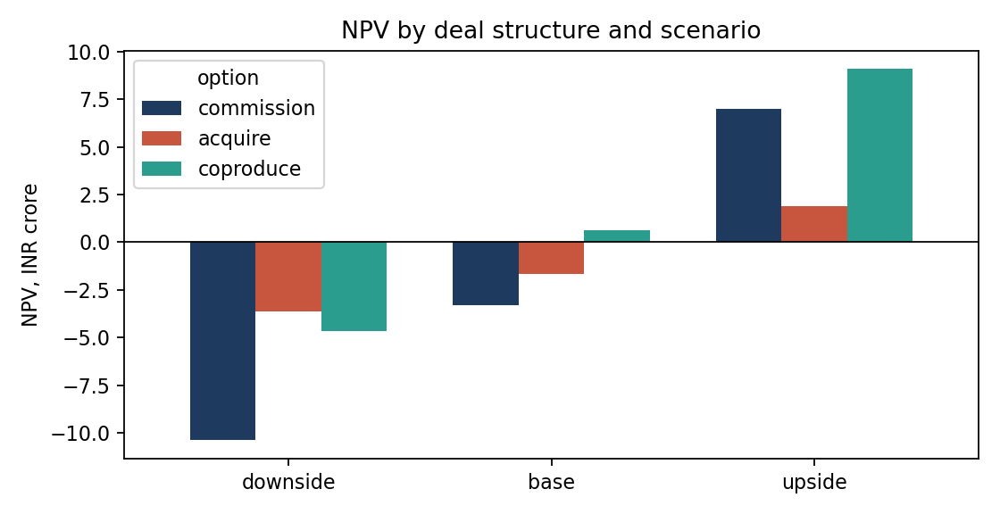

# The Economics of OTT Content Investment: Commission, Acquire or Co-produce?

A decision model for a hypothetical mid-sized Indian streaming platform choosing how to fund one six-episode scripted series.

> **Hypothetical case.** Public sources anchor market size and prices. Costs, fees, subscriber uplift, churn and ad rates are documented assumptions with ranges, not market quotes.

## Business problem
A platform with a limited content budget can commission an original, license an existing title, or co-produce with a partner. Each structure trades cost, speed, rights and risk differently.

## Research question
Under what financial and commercial conditions does commissioning make more sense than acquiring or co-producing?

## Why it matters
Indian platforms have reportedly cut per-episode budgets since the 2020–21 peak while paid video subscriptions reached 216 million in 2025 (FICCI-EY). Deciding which titles deserve full ownership is now a central commercial question for content and strategy teams.

## Data and sources
- `docs/source_register.csv`: six public sources with retrieval date, method and whether each was verified directly.
- `docs/assumptions_register.csv`: 41 parameters, each typed (assumption / case definition) with low, base, high and rationale. This file drives both the Python and Excel models.

## Methodology
Monthly cash-flow model of **incremental** contribution: title-driven subscriber cohorts with churn, retention of existing subscribers, advertising from non-paying viewers only (no double counting with ARPU), secondary and residual rights. NPV at 12%, payback, break-even and indifference solving, one-at-a-time sensitivity, two-way decision grids, and a 20,000-draw Monte Carlo with a skewed title-performance distribution. Details: `docs/methodology.md`.

## Key findings (base case: premium series at INR 1.5 crore per episode; INR crore, PV)
| | Commission | Acquire | Co-produce |
|---|---|---|---|
| PV of costs | 13.7 | 5.3 | 7.9 |
| NPV | -3.3 | -1.6 | +0.7 |
| Break-even incremental subscribers | 255k | 109k | 164k |
| NPV at INR 1.0 crore per episode | +0.5 | -0.0 | +2.9 |
| P(NPV > 0), simulation | 24% | 17% | 38% |
| Worst-5% average NPV | -19.3 | -8.0 | -10.5 |

- Subscriber acquisition is 76–89% of contribution in every structure; advertising would need about 18–21x the assumed ad-tier audience to carry the case alone.
- Commissioning beats co-production only if post-horizon rights are worth about 108% of production cost (assumed 10%) or the title performs at about 3.2x plan.
- The base cost sits above the INR 0.3–1 crore range trade press reports for current commissioning; at INR 1 crore, commissioning is marginally positive.
- The median simulated outcome is negative for all three structures: the mean is carried by a minority of hits.
- Acquisition never leads on expected value but has the smallest tail loss and a one-month lead time.



## Dashboard
**No Tableau workbook is included.** Tableau was not available when this was built. `tableau/` contains twelve Tableau-ready CSVs, calculated-field definitions and a page-by-page specification with a wireframe. The figures in `reports/figures/` are static matplotlib charts.

## Business implications
See `reports/executive_report.md` and `reports/executive_presentation.pptx`: co-production is preferred for a single season if the assumed partner terms are obtainable; commission when ownership beyond year three is the point; acquire when capital or time is the constraint; walk away below about 165k incremental subscribers unless the purpose is explicitly strategic.

## Limitations
Inputs are mostly assumptions; subscriber attribution is an input, not an estimate; partner-side economics are not modelled; one title in isolation. Full list: `docs/limitations.md`.

## Reproduce
```bash
python -m venv .venv && source .venv/bin/activate
pip install -r requirements.txt
pytest -q                      # 22 tests, including Excel-vs-Python reconciliation
python scripts/run_all.py      # Excel model, Tableau CSVs, figures
python scripts/build_deck.py   # executive presentation
```
To change the case, edit `docs/assumptions_register.csv` (or the yellow cells in the Excel workbook) and re-run.

## Repository layout
```
docs/       problem definition, methodology, assumptions, sources, limitations, decisions
src/        ott_model package (params, model, analysis, excel_export)
model/      Excel workbook with live formulas
scripts/    run_all.py, build_deck.py
notebooks/  executed walkthrough
tableau/    Tableau-ready data, calculated fields, dashboard specification
reports/    executive report, presentation, figures
tests/      model logic and Excel reconciliation tests
```

## Tools
Python (NumPy, pandas, SciPy, matplotlib, openpyxl, python-pptx), Excel, pytest. Tableau specification only.
